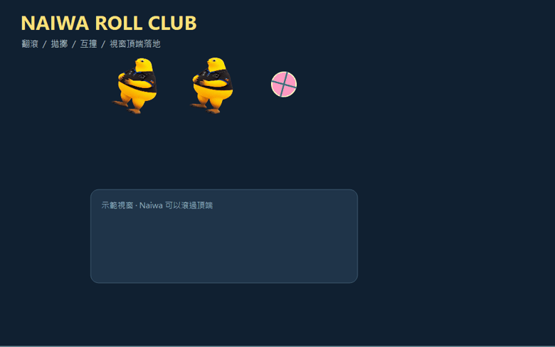

# Naiwa Roll Club

把黃色 Naiwa 放到 Windows 或 Linux 桌面上，抓起來、甩出去，看牠翻滾、碰撞、互相彈開。



## 直接玩

下載 Releases 的 **Naiwa-Windows-x64.zip**，解壓後雙擊 **Naiwa.exe**。不需要安裝 Python。Windows 10 / 11 x64；未簽章的自行開發程式可能顯示 SmartScreen 提醒。

點右下角系統托盤的 Naiwa 圖示，或右鍵桌寵 →「Naiwa 控制室」。托盤圖示可能收在 `^` 裡。關閉控制室只會收起視窗；真正退出請用托盤或桌寵右鍵 →「退出 Naiwa」。

### Ubuntu / Linux Mint

主要支援 Ubuntu 22.04 / 24.04 與 Linux Mint 21 / 22 的 **x86_64、X11 / XWayland** 桌面。下載 Releases 的 **Naiwa-Linux-x64.tar.gz**，保留解壓後的整個 `Naiwa` 資料夾；執行檔旁邊的 `_internal` 不可移走。

首次使用，安裝 Qt 的系統圖形套件與中文字型：

```bash
sudo apt update
sudo apt install libegl1 libgl1 libdbus-1-3 libfontconfig1 libx11-xcb1 libxkbcommon-x11-0 libxcb-cursor0 libxcb-icccm4 libxcb-image0 libxcb-keysyms1 libxcb-render-util0 libxcb-xinerama0 libxcb-xfixes0 libxcb-shape0 libxcb-xinput0 fonts-noto-cjk
tar -xzf Naiwa-Linux-x64.tar.gz
cd Naiwa
bash start.sh
```

Linux 版保留翻滾、拖曳拋擲、互撞、餵食、模式與專注功能，使用 X11 讀取其他視窗頂端與標題列邊界。Mint Cinnamon / Xfce / MATE 的 X11 桌面可直接使用。透明效果需要桌面開啟 compositing，正常的 Cinnamon 與 GNOME 桌面通常已開啟。

Ubuntu 的 Wayland 桌面會自動用 **XWayland (`xcb`)** 啟動。XWayland 可以提供桌寵移動，但只能取得 X11 / XWayland 應用程式的位置，無法對原生 Wayland 視窗做頂端碰撞。需要完整視窗碰撞時，在登入畫面的齒輪選單選 **Ubuntu on Xorg**。純 Wayland 且沒有 XWayland / `DISPLAY` 的環境不支援桌面版，啟動會顯示操作指引，不會假裝可以任意移動視窗。[Qt 的 Wayland 視窗定位限制](https://doc.qt.io/qt-6/application-windows.html)

沒有系統托盤的 GNOME 桌面會自動顯示控制室，控制室另有「退出 Naiwa」按鈕；也能右鍵桌寵操作。Linux 設定依 `QStandardPaths` 儲存在 `$XDG_DATA_HOME/Naiwa/NaiwaRollClub/`（一般是 `~/.local/share/Naiwa/NaiwaRollClub/`）。

## 玩什麼

| 操作 | 反應 |
|---|---|
| 左鍵輕點 | 摸摸、跳一下、愛心與隨機回話 |
| 拖曳後放開 | 根據最近的拖曳速度拋擲，有重力、反彈和旋轉 |
| 左鍵雙擊 | 高速旋風跳躍 |
| 滑鼠滾輪 | 改變所有 Naiwa 的大小 |
| 螢幕邊緣 / 地板 | 反彈、壓扁回彈、碰撞粒子與連擊 |
| 其他可見視窗頂端 | 落地與翻滾；往上跳可以穿過頂端 |
| 增加 Naiwa | 最多六隻，互相碰撞，大小會影響碰撞質量 |
| 丟球 | 最多四顆可抓起來丟的彈力球 |
| 餵甜甜圈 | Naiwa 會靠近點心，吃掉後恢復飽足與精神 |
| 全員發射 | 全員同時飛出去翻滾 |
| 反重力 | 十秒往上飄；也可以開啟月球低重力 |

自由翻滾、追滑鼠、暴走派對、睡覺和專注陪伴共五種模式。專注可選 5 / 15 / 25 / 50 分鐘，Naiwa 會安靜陪伴，結束時提醒你休息。切換到其他模式會取消這次專注倒數。

控制室顯示累積碰撞、拋擲、摸摸、吃點心、最佳連擊與完成的專注次數。設定與紀錄存在 `%LOCALAPPDATA%/Naiwa/NaiwaRollClub/`；退出時與每 30 秒保存。暫停停止物理和自動行為，專注倒數繼續走；暫停時仍可拖曳搬動桌寵。找不到桌寵可用「全員回家」。

透明處不攔截滑鼠。程式不更動其他視窗，視窗碰撞只讀取可見視窗位置。每隻桌寵使用所在螢幕的工作區域，可以拖到其他螢幕；邊界會反彈，沒有跨螢幕自由穿越。視窗頂端碰撞是矩形近似，重疊、特殊透明視窗和快速移動視窗可能有短暫誤差，可在控制室關閉。

## 原始碼執行與打包

需要 Python 3.10+（建議 3.12）與 Windows x64 或 Linux x86_64。

```powershell
python -m venv .venv
.venv/Scripts/python.exe -m pip install -r requirements.txt
.venv/Scripts/python.exe naiwa.py --panel
```

也可雙擊 `start.cmd`。打包執行 `powershell -ExecutionPolicy Bypass -File build.ps1`，產出 `dist/Naiwa.exe` 與可分發 ZIP。

打包使用 `packaging/Naiwa.spec`，排除其他程式放在 PATH 中的 ICU DLL 與 Windows API-set DLL，讓 Qt 使用 Windows 自帶的 ICU。打包後會執行 `verify_build.ps1`，實際啟動成品並檢查 Qt 載入、桌寵繪製、控制室與視窗偵測成功後才產生 ZIP。GitHub Actions 同樣檢查成品啟動。

Linux 原始碼執行：安裝上面的系統圖形套件以及 `python3-venv`，在圖形桌面裡執行 `bash start.sh`。Linux 打包執行 `bash build-linux.sh`，產出 `dist/Naiwa-Linux-x64.tar.gz`。Linux 有獨立的打包設定，保留 Qt 自己的 Linux ICU libraries；不使用 Windows 的 DLL 排除規則。CI 在 Ubuntu 22.04 / Xvfb 中執行互動測試與真正的 X11 視窗偵測，再打包及啟動 Linux 執行檔；這不能代替每個實際桌面環境的目視測試。

必要驗證：`.venv/Scripts/python.exe -m unittest test_naiwa -q`，涵蓋高速碰撞邊界、動量、不同尺寸、拖曳固定物體、負座標螢幕、視窗落地、點擊、點心、數量上限、專注與設定保存。

來源與素材授權見 [THIRD_PARTY.md](THIRD_PARTY.md)。
